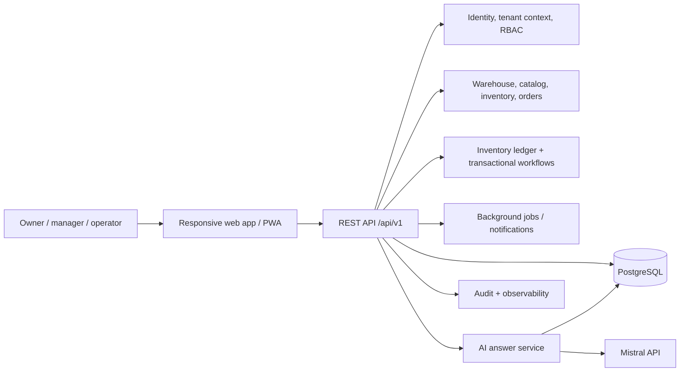
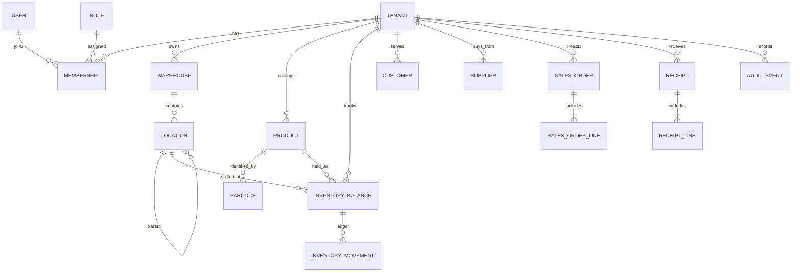

# Stockpilot architecture

## Product architecture

Stockpilot is a Pakistan-first, SME-friendly warehouse and trading operations SaaS. It is organized as a **modular monolith**: one API deployment and one relational database, with clear domain modules. This keeps deployment and operations practical for an early product while preserving boundaries that can be extracted later if usage requires it.

The browser is an interaction layer only. Authorization, valuation, availability, reservation, approval, and inventory movement rules belong in the API. In local development SQLite is the source of truth; the intended hosted database is PostgreSQL. Any inventory mutation writes an immutable movement and updates the balance in the same transaction; AI cannot directly write operational or financial records.

## Module architecture

| Module | Responsibilities |
| --- | --- |
| Identity and tenancy | Login/session, company, memberships, invitations, role and permission evaluation |
| Warehouse layout | Warehouses, zones, aisles, racks, shelves, bins, capacity and labels |
| Catalog | Products, categories, barcode aliases, units, dimensions and tracking policy |
| Inventory | Tenant/owner/location/product/lot balances, reservations, ledger and counts |
| Inbound | Purchase orders, receipts, inspection, GRN and putaway tasks |
| Outbound | Sales orders, reservations, pick/pack tasks, shipments and dispatch |
| Trading | Customers, suppliers, pricing, receivables/payables and returns |
| Business intelligence | Dashboard aggregates, reports, exports and alert rules |
| Audit and platform | Append-only activity trail, platform tenants/plans, health and feature flags |
| AI | Intent routing, permission-aware query tools, grounded summaries and usage records |

## Database ERD

All tenant-owned tables carry `tenant_id`. Unique constraints include that key; tenant-scoped foreign keys prevent cross-company relationships. API queries derive tenant context from the authenticated membership and never accept a trusted tenant id from request payloads. PostgreSQL row-level security is a defense-in-depth option for hosted deployments; API tenant scoping is mandatory either way.

## Database schema proposal

The initial migration is in `db/migrations/0001_foundation.sql`. It defines tenants, users, roles, memberships, warehouse locations, products and barcodes, stock balances and immutable movements, customers/suppliers, order/receipt headers and lines, and audit events. Follow-up migrations add approval workflows, expenses, subscription plans, storage billing, alerts and integrations.

Inventory identity is `(tenant_id, owner_id, warehouse_id, location_id, product_id, lot_code, status)`. Quantities are decimal numeric values to support fractional units. A movement stores signed quantity, type, reference, actor, time and resulting balance. Mutations lock affected balance rows and commit movement, balance, reservation and audit records atomically. Transfers are represented by paired source/destination movements under one transfer reference.

## Authentication architecture

Use short-lived signed access tokens and rotating, hashed refresh-token sessions in secure, HttpOnly, SameSite cookies. Passwords use Argon2id. Login is followed by explicit tenant membership selection when the user has multiple companies. Every request resolves user → active membership → tenant → permissions. Password reset and invitation tokens are single-use and stored hashed. Production secrets are environment-managed and never shipped to the web client.

## Roles and permissions

Permissions are stable action identifiers such as `inventory.read`, `inventory.adjust`, `orders.fulfill`, and `finance.read`. Roles are tenant-scoped permission bundles; custom roles can be added by owners. This matrix is the default grant set; explicit grants can extend warehouse-manager financial access.

| Capability | Owner | Manager | Controller | Operator | Sales | Purchase | Accountant | Auditor | Platform admin |
| --- | --- | --- | --- | --- | --- | --- | --- | --- | --- |
| Company, users, roles, settings | Full | Read / delegated | — | — | — | — | — | Read | Platform only |
| Warehouses, locations, tasks | Full | Full | Read | Assigned tasks | Read | Read | Read | Read | — |
| Products, inventory, counts | Full | Full | Full | Task-scoped | Availability | Read | Valuation read | Read | — |
| Receiving and purchasing | Full | Full | Receive / inspect | Assigned receipt | — | Full | Read | Read | — |
| Sales, picking, dispatch | Full | Full | Inventory execution | Assigned tasks | Full sales | — | Read | Read | — |
| Financial records and reports | Full | No by default | — | — | Own sales view | Own purchasing view | Full | Read | Platform billing only |
| Audit history | Full | Operational scope | Stock scope | Own actions | Sales scope | Purchase scope | Financial scope | Full read-only | Platform scope |
| Tenant / plan administration | — | — | — | — | — | — | — | — | Full platform scope |

Platform administration uses a separate principal and API namespace. A platform admin has no implicit access to a tenant's operational data.

## API structure

Base path `/api/v1`; JSON responses use `{ "data": ..., "meta": ... }` and errors use `{ "success": false, "error": { "code": "...", "message": "...", "details": [] } }`. Collection endpoints accept `page`, `pageSize`, `q`, `sort`, and domain filters. Mutating requests accept an idempotency key where retries could duplicate work.

Initial resources: `/auth`, `/companies`, `/memberships`, `/roles`, `/warehouses`, `/locations`, `/products`, `/inventory`, `/inventory/movements`, `/receipts`, `/transfers`, `/sales-orders`, `/picking-tasks`, `/shipments`, `/reports`, `/audit-events`, `/alerts`, `/ai/chat`. `API.md` records representative contracts.

## Mistral architecture

The AI service identifies a supported intent and invokes permission-checked, read-only query functions. Those functions execute parameterized, tenant-scoped queries and return typed facts plus the reporting window and units. Only those structured results are sent to Mistral to produce an explanation. Responses include source facts and the data timestamp. Unknown or unsupported questions get a clarification. Tool output is validated; model text is never parsed as an instruction to execute SQL or mutate stock. AI usage, latency, errors and token counts are recorded without logging secrets.

## MVP implementation plan

1. Foundation: responsive command center, typed client, schema, tenant authentication, membership and RBAC.
2. Warehouse setup: warehouses and hierarchical scannable locations.
3. Product master and inventory ledger: barcode aliases, balances, adjustments, counts and audit.
4. Inbound: PO, receipt, GRN, quality inspection and putaway.
5. Outbound: customer order, reservation, picking, packing and dispatch.
6. Dashboard, filtered reports, alerts and export.
7. Database-grounded Mistral copilot.
8. Security, migration, API and workflow verification; deployment and operational setup.

Phase 2 adds richer trading, returns, expenses, storage billing and alerts. Phase 3 adds forecasting, slotting, extraction and external integrations after reliable history exists.
